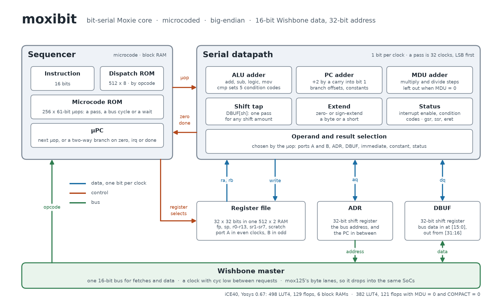
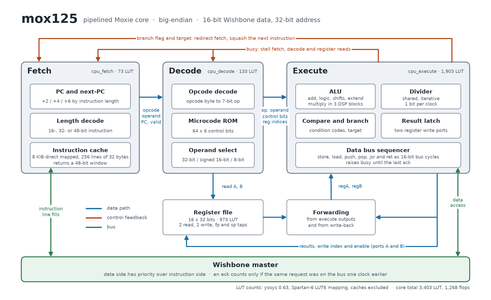
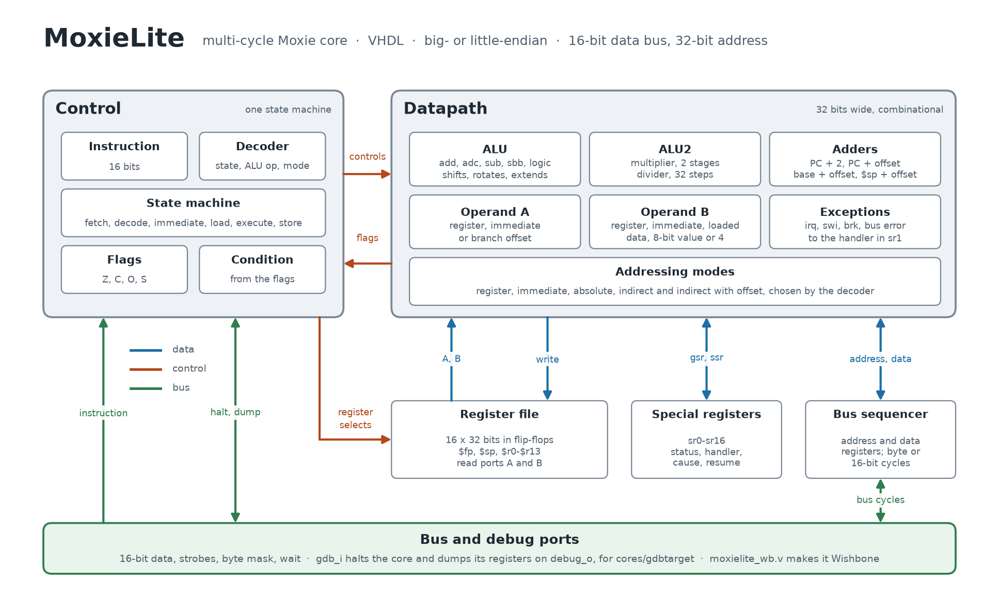

moxie-cores
===========

Hardware implementations of [Moxie](http://moxielogic.org/blog/), a
small 32-bit processor architecture designed around what a C compiler
needs.  Moxie has sixteen 32-bit registers, 16-bit instructions with
optional 16- or 32-bit immediates, and a handful of addressing modes.
It has been supported by the official GNU toolchain since 2009, when
the port went into binutils and GCC; newlib provides its C library.

This repository has three Moxie cores, the peripherals and
systems-on-chip around them, simulators, and the tests that keep them
honest.

Quick start
-----------

Run a program on a Moxie system in simulation.  You need
[FuseSoC](https://github.com/olofk/fusesoc) and
[Verilator](https://verilator.org) 5, and nothing else: the program is
checked in.

    pip install fusesoc
    git clone https://github.com/atgreen/moxie-cores
    cd moxie-cores
    fusesoc --cores-root . run --target=sim moxielogic:moxie-cores:bala --expect="moxie!"

That builds Bala, the smallest Moxie system, around the moxibit core,
and prints what it sends on its serial port:

    Hello from moxie!

Add `--flag=mox125` to run the same program on the mox125 core
instead.

Cores
-----

**[moxibit](cores/moxibit/README.md)** computes one bit per clock, in
the style of [SERV](https://github.com/olofk/serv), and is
microcoded.  It implements the whole instruction set, with mox125's
exceptions and bus, but no MMU.  Options drop the multiplier and
divider, for software to emulate, or buy speed with a few more LUTs.

**mox125** is pipelined: fetch with an instruction cache, decode,
execute and write-back, with forwarding.  It has exceptions,
interrupts, a software-refilled MMU and the extensions an operating
system wants (`eret`, `wfi`, `cas.l`).

**MoxieLite** is a bi-endian, non-pipelined implementation in VHDL.

mox125 and moxibit also implement the
[compact-code extension](docs/compact.md): short forms of constants,
shifts, compares, branches, calls, loads and stores, a 3-operand add,
multiple-register push and pop, and a global pointer.  With it, moxie
code is 10% smaller than compressed RISC-V (RV32IC), about the size of
RV32IMC, and 37% smaller than RV32I.

Both Verilog cores are big-endian and talk to the same 16-bit
Wishbone bus with 32-bit addresses, so they are interchangeable: each
provides a `moxie_cpu` module with the same ports.  How they compare,
synthesized alone for ECP5 with Yosys:

| Core                        | LUT4  | Flip-flops | Block RAM |
|-----------------------------|------:|-----------:|----------:|
| moxibit                     |   564 |        129 |         4 |
| moxibit without mul/div     |   519 |        121 |         4 |
| moxibit without mul/div or the extension | 446 | 121 | 4 |
| mox125, 256-byte icache     | 6,761 |      1,696 |         2 |

[cores/moxibit/README.md](cores/moxibit/README.md) compares moxibit
with SERV.

Systems-on-chip
---------------

* **[Bala](soc/bala/README.md)** - either core, RAM preloaded with a
  program, and a serial port, timer and interrupt controller; for the
  iCEBreaker (iCE40 UP5K) and the ULX3S (ECP5).
* **Muskoka** - mox125 with a boot loader, for the Digilent Nexys 3
  ([README](soc/muskoka/boards/nexys3/README.md)), with 16 MB of RAM,
  and the original Altera DE2.
* **Marin** - MoxieLite, for the Nexys 3 and the DE2.

Bala, the Nexys 3 SoC and the simulators share one memory map: RAM
from address zero, programs at 0x1000, and the peripherals at
0xF0000000.  What runs on one runs on the others.

Wishbone peripherals live in `cores/`: a UART, a 16550, a timer,
interconnect, cellular RAM and SDRAM controllers, displays.

Software
--------

* The GNU toolchain: `moxie-elf` binutils, GCC and newlib.
  `scripts/build-toolchain.sh PREFIX` builds it from release tarballs,
  with patches for mox125's `eret`, `wfi` and `cas.l` and for the
  compact-code extension (`-mcompact`, `-mgp`); it takes about ten
  minutes.
* `firmware/` has boot loaders and ROMs, `firmware/hello` the program
  above, and `firmware/moxibit/mdu-emulate.S` the multiply and divide
  emulation for moxibit built without them.
* Zephyr and Linux have been ported to mox125: the `moxie` branches of
  [atgreen/zephyr](https://github.com/atgreen/zephyr) and
  [atgreen/linux-moxie](https://github.com/atgreen/linux-moxie).
  The boot loader on the Nexys 3 SoC loads programs as S-records
  over its serial port.
* [docs/abi.org](docs/abi.org) describes the calling convention, and
  [docs/compact.md](docs/compact.md) the compact-code extension.
  `tools/codesize/codesize.sh` measures code size against RISC-V.

Simulation and testing
----------------------

* `bench/moxibit` - moxibit's tests.  `make check` runs every test
  program on the core at several bus speeds and on the instruction
  set simulator, and `make lockstep` compares the two instruction by
  instruction, every register.
* `bench/mox125` - mox125's tests, in Common Lisp with
  [wrapilator](https://github.com/atgreen/wrapilator).
* `bench/mox125-board` - mox125 on a simulated board, fast enough to
  boot Linux.
* `bench/nexys3-soc` - the Nexys 3 SoC with models of its RAM and a
  terminal.
* `tools/mox125-iss` - an instruction-level simulator, hundreds of
  times faster than the RTL.  It is kept in step with mox125, and
  moxibit is checked against it.

`scripts/run-tests.sh` runs everything that CI runs.  It needs
Verilator 5, wrapilator, SBCL, [ocicl](https://github.com/ocicl/ocicl)
and the `moxie-elf` toolchain;
[.github/workflows/ci.yml](.github/workflows/ci.yml) shows how to get
them.  [HACKING](HACKING) has the details.

FuseSoC
-------

Every core, peripheral and system has a FuseSoC core file, so this
repository works as a FuseSoC library: use `--cores-root` on a
checkout, or

    fusesoc library add moxie-cores https://github.com/atgreen/moxie-cores

The cores are named `moxielogic:moxie-cores:<name>`; `fusesoc core
list` shows them and `fusesoc core show <name>` their targets.

* `moxibit`, `mox125` - the cores, with lint targets.  Both provide the
  virtual core `moxielogic:moxie-cores:cpu`, so a system that depends
  on it can be built with either; `--flag=mox125` chooses mox125.
* `bala` - targets `sim`, `icebreaker` and `ulx3s`.
* `muskoka-nexys3`, `muskoka-de2` - targets `nexys3` (ISE 14.7) and
  `de2` (Quartus II 13.0sp1).
* `moxibit-bench`, `mox125-board`, `nexys3-soc` - simulations that run
  a program given with `--program=`, or `--srec=` for the Nexys 3 SoC.

`scripts/fusesoc-check.sh` runs every lint and simulation target.

Repository layout
-----------------

| Directory   | What is there                                               |
|-------------|-------------------------------------------------------------|
| `cores/`    | the CPU cores and the Wishbone peripherals                  |
| `soc/`      | systems-on-chip, with a directory per board                 |
| `bench/`    | simulation test benches                                     |
| `firmware/` | boot loaders, ROM images and small programs                 |
| `tools/`    | the instruction set simulator, toolchain patches and builds |
| `scripts/`  | test runners and code generators                            |
| `docs/`     | the ABI, and diagrams                                       |

Contributing
------------

Report bugs as [GitHub issues](https://github.com/atgreen/moxie-cores/issues).
Pull requests are welcome; CI runs `scripts/run-tests.sh` on each
one.  A change to what an instruction does wants the same change in
`tools/mox125-iss`, which both cores' tests agree with.

License
-------

moxie-cores is free software.  Unless a file says otherwise it is
distributed under the GNU General Public License version 2; some
cores that came from elsewhere keep their own licenses.  See
[LICENSE](LICENSE) for which.

Anthony Green
<green@moxielogic.com>
